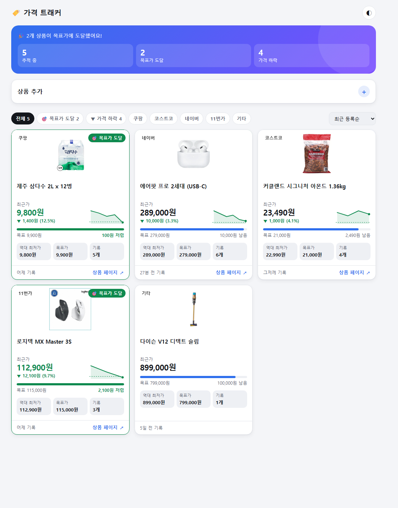
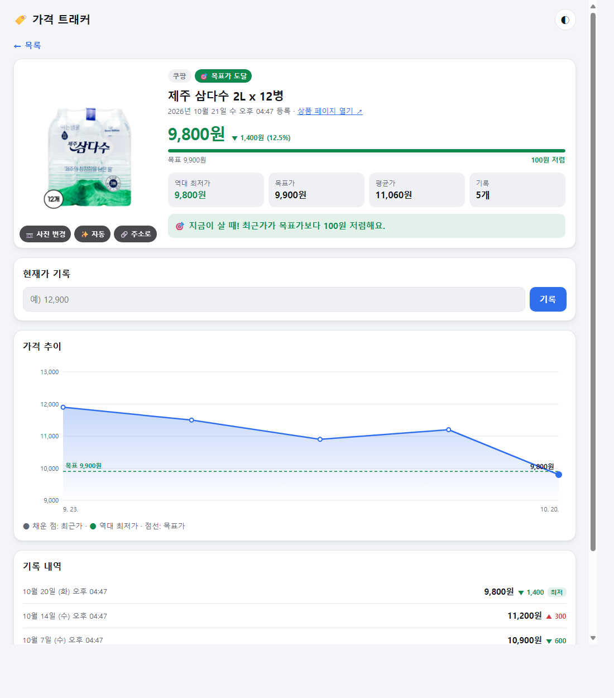

# 🏷️ 가격 트래커

쇼핑몰 상품 가격을 직접 기록하고, 가격 추이와 목표가 도달 여부를 한눈에 보는 미니 웹앱입니다.
HTML 파일 하나 + Supabase로 동작하며, 빌드 과정 없이 정적 호스팅에 바로 배포할 수 있습니다.

**배포 링크:** <!-- TODO: https://your-app.vercel.app --> _준비 중_

## 스크린샷

| 상품 목록 | 상품 상세 |
| --- | --- |
| <!--  --> _스크린샷 자리_ | <!--  --> _스크린샷 자리_ |

## 기능

- **상품 등록** — 이름, 쇼핑몰(쿠팡/코스트코/네이버/11번가/기타), 상품 URL, 목표가 (등록 시 현재가도 바로 기록 가능)
- **상품 목록** — 카드마다 최근가 · 역대 최저가 · 목표가 · 기록 개수, 최근가 ≤ 목표가면 🎯 "목표가 도달" 강조, 상품 페이지 링크
- **상품 상세** — 현재가 기록 추가, 인라인 SVG 라인 차트(외부 차트 라이브러리 없음), 직전 대비 증감이 표시되는 기록 내역
- 원 단위 천 단위 콤마, 한국어 날짜 형식
- 모바일 우선 반응형, 라이트/다크 모드(시스템 설정 + 수동 전환)
- 사용자 입력 HTML 이스케이프, `http(s)` 링크만 허용
- RLS·API 키·테이블 누락 등 에러 원인을 화면에 안내

## 기술 스택

| 영역 | 사용 기술 |
| --- | --- |
| 프론트엔드 | 단일 `index.html` (Vanilla JS, 인라인 CSS/JS, 인라인 SVG 차트) |
| 백엔드 / DB | [Supabase](https://supabase.com) (PostgreSQL + Row Level Security) |
| 클라이언트 | `@supabase/supabase-js` v2 (jsDelivr CDN, 버전 고정) |
| 배포 | Vercel 또는 Netlify 정적 호스팅 |

## 시작하기

1. Supabase 프로젝트를 만들고 **SQL Editor**에서 [`schema.sql`](schema.sql)을 실행합니다.
   - (선택) 상품 사진 업로드/변경을 쓰려면 [`migrations/002_images.sql`](migrations/002_images.sql)도 실행합니다.
2. **Project Settings → API**에서 Project URL과 `anon` `public` 키를 복사해 `index.html` 맨 위 상수에 채웁니다.
   ```js
   const SUPABASE_URL = "https://xxxx.supabase.co";
   const SUPABASE_ANON_KEY = "eyJ...";
   ```
   > ⚠️ `service_role`(secret) 키는 절대 넣지 마세요. 넣으면 앱이 실행을 거부합니다.
3. 로컬에서 실행합니다.
   ```bash
   npx serve .
   ```
   브라우저에서 http://localhost:3000 을 엽니다.

## 자동 이미지 (선택)

상품 URL을 붙여넣으면 Edge Function [`og-image`](supabase/functions/og-image/index.ts)가 페이지의 대표 이미지(`og:image` 등)와 상품명을 가져옵니다.

1. Supabase 대시보드 → **Edge Functions** → **Deploy a new function** → **Via Editor**
2. 이름을 `og-image`로 정하고 `supabase/functions/og-image/index.ts` 내용을 붙여넣은 뒤 **Deploy**
3. 함수 **Settings**에서 **Verify JWT (legacy)** 를 끕니다 (publishable 키는 JWT가 아니므로)

| 쇼핑몰 | 동작 |
| --- | --- |
| 코스트코 | ✅ 상품 이미지·이름 (상품 JSON 사용) |
| 일반 쇼핑몰 / 브랜드몰 | ✅ 대부분 `og:image` 제공 |
| 11번가 · 네이버 | 페이지에 따라 다름 |
| 쿠팡 | ❌ 자동 접근 차단(403) → 사진 직접 업로드 |

> 데모용 기능입니다. 쇼핑몰 페이지를 서버에서 가져오므로 각 사이트 이용약관을 확인하세요.

## 배포

- **Vercel**: `npx vercel` (프레임워크 프리셋: Other, 빌드 명령 없음) 또는 GitHub 저장소 연결
- **Netlify**: [app.netlify.com/drop](https://app.netlify.com/drop)에 폴더를 드래그 앤 드롭하거나 GitHub 저장소 연결 (빌드 명령 없음, 배포 디렉터리 `.`)

## 보안 메모

- anon 키는 공개되어도 되는 키이며, 실제 권한은 RLS 정책이 결정합니다.
- `002_images.sql`을 실행하면 누구나 이미지를 업로드(5MB, 이미지 형식만)하고 상품 이미지(`image_url` 컬럼만)를 바꿀 수 있습니다.
- 현재 정책은 누구나 **조회/추가**만 가능하고, 이미지 외의 수정·삭제는 불가능합니다. 데모용이므로 공개 배포 시 누구나 데이터를 추가할 수 있다는 점에 유의하세요. 개인용으로 쓰려면 Supabase Auth를 붙이고 정책을 `auth.uid()` 기준으로 바꾸세요.

## 다음 단계

- [ ] **네이버 쇼핑 API + Supabase pg_cron으로 매일 자동 가격 수집**
  - Supabase Edge Function에서 네이버 쇼핑 검색 API를 호출해 최저가를 조회하고 `price_logs`에 저장
  - `pg_cron` + `pg_net`으로 매일 정해진 시간에 Edge Function 호출
- [ ] 목표가 도달 시 알림 (이메일 / 카카오톡)
- [ ] 상품 수정·삭제 (인증 도입 후)
